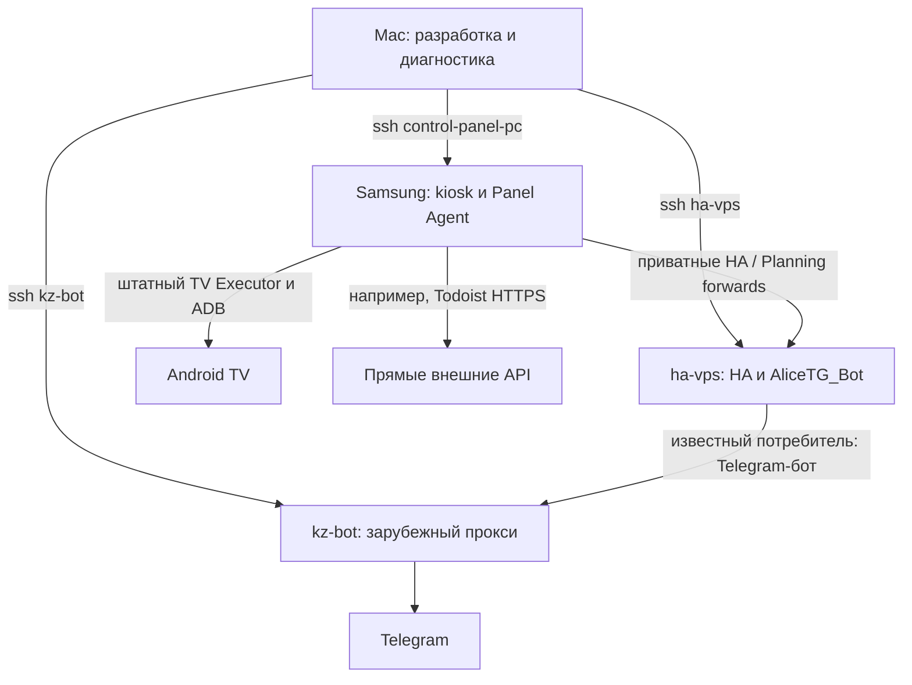

# Карта репозитория и runtime — Artem Control Center

Карта составлена по структуре `decorum-guy/artem-control-center` и документам проекта. Пути к production-host и сервисам ниже **документированы в репозитории**, но должны сверяться агентом на живой машине: они не подтверждают текущее состояние сами по себе.

## 1. Быстрая модель

Инфраструктурные узлы и SSH alias описаны в [INFRASTRUCTURE_ACCESS.md](INFRASTRUCTURE_ACCESS.md).

Схема объединяет документированную топологию и сведения владельца; она не является текущим health-снимком. Временное отключение прокси отмечается только в датированной заметке карты доступа.

Не путать сеть с источником истины. HA — authority устройств его интеграций; AliceTG_Bot Planning — календаря/наследуемых задач/напоминаний; Todoist — отдельной вкладки `/tasks` при включённом provider. Кандидат PR #372 добавляет независимые источники: локальный Glagol для музыки, Calendar Notes для нативных напоминаний и BLE для ленты спальни. В Overview карточка «Дела» остаётся Planning-based, см. [TODOIST_TASKS.md](TODOIST_TASKS.md). Сетевая связность Samsung→VPS и Samsung→Todoist — независимые пути.

### Основная панель, кандидат и следующая функция

Основания для статуса — [принятый выпуск](plans/SAMSUNG_RELEASE_MANIFEST_2026_11_24.md), [приёмка #375 и #376](plans/GOOGLE_LOGIN_UX_AND_NEXT_RELEASE_2026_11_24.md) и [аудит push и дополнений](plans/ALICE_PUSH_REVIEW_AND_RELEASE_2026_11_25.md).

| Объект | Последнее документированное состояние |
| --- | --- |
| Основной Samsung runtime | `2b361918f11b`, основной loopback-порт `8787`, проверен на Samsung. |
| Preview Samsung | При сверке 25.11 порт `8797` обслуживает ранее принятый `ae376d22` до 26.11.2026 21:32 МСК. Временный `8798` #376 истёк, диагностический `8799` #377 остановлен. Общий кандидат проверяется в отдельном read-only preview. [Манифест](plans/SAMSUNG_RELEASE_MANIFEST_2026_11_24.md). |
| Кандидат выпуска | [PR #375](https://github.com/decorum-guy/artem-control-center/pull/375) против main объединяет ранее принятый #375, окно Google и выбор ленты из #376, guard переноса из #377. Точный head и прогоны фиксируются в release PR. Предыдущие ревизии перечислены в [аудите](plans/ALICE_PUSH_REVIEW_AND_RELEASE_2026_11_25.md). |
| Напоминания и BLE | Озвучка Mini 2 принята. Владелец подтвердил один phone-only push с формы панели после переноса на `b1ee01cf`. Пустой origin совместим с этой доставкой. Причина прежних недоставок неизвестна. Дополнительные прогоны остановлены, второе phone-only и «На оба» остаются непроверенными. #377 проверяет сохранение области, origin и play_settings при переносе. BLE после восстановления физически подтверждался ранее. [Результат](plans/ALICE_PUSH_REVIEW_AND_RELEASE_2026_11_25.md). |
| Сохранение текущей песни | Принято владельцем одно раннее «Сохраняю» через существующий Glagol; итог показывается на панели. Поздние музыкальные реплики удалены. Официальный OAuth подтвердил точный лайк через Happ. Наличие этого лайка в библиотеке Music в третьем раунде отдельно не подтверждено. [Актуальный статус](YOUTUBE_CURRENT_TRACK.md). |
| Страница «Музыка» в кандидате | Плеер, Яндекс «Мне нравится» + собственные/понравившиеся плейлисты с обложками; их код адресно проверен, живые результаты — в отчёте. Браузерное чтение YouTube восстановлено; по отчёту каталог 41 пункт и реальные продолжения. P2 ложного пустого каталога исправлен. В #375 реализовано подключение и headless recovery из выделенного Edge-профиля; проверены подготовленная сессия и обычная ротация. [Последующая проверка восстановления, рестарта и входа](plans/YOUTUBE_CONNECTION_REVIEW_375_2026_11_24.md). |
| Кондиционер в кандидате | R4 закрыт. Температура и последующее fan five → one имеют один HA context; отдельного set_fan_mode в проверенном интервале не найдено. Интеграция отправляла только temperature. Причина fan неизвестна. Последнее сообщение владельца: 10:59 МСК, off, цель 31 °C, fan one; автор карты это не перечитывал. |
| Следующий этап и CI | [Манифест общего выпуска](plans/SAMSUNG_RELEASE_MANIFEST_2026_11_24.md). Прогоны #375, #376 и #377 относятся к их историческим SHA. Общий кандидат проверяется против main на head release PR. Штатная установка остаётся отдельным поручением. |

До установки кандидата не описывать его модули как уже работающие в основной панели. Для кодовых ссылок на эти модули использовать ревизию кандидата, а не предполагать их наличие в `main`.

При разрешённом переходе preview → основной runtime следовать актуальному манифесту #375: сначала остановить preview и его получатели, освободить BLE и перенести историю, затем включить единственный основной получатель. Подробный порядок и откат — в отчёте кандидата. Публикация этого документа не выполняет установку.

## 2. Корень проекта

| Путь | Назначение |
| --- | --- |
| `README.md` | назначение продукта, основные разделы, способы запуска |
| `AGENTS.md` | основной набор требований к агентам |
| `RULES.md` | краткие обязательные правила безопасности и workflow |
| `package.json` | npm workspaces и канонические build/test команды |
| `apps/dashboard/` | React/Vite dashboard: маршруты, виджеты, UX, тесты |
| `apps/panel-agent/` | FastAPI Panel Agent: интеграции, access, snapshot, API, Python tests |
| `apps/jarvis-voice/` | отдельные материалы/компоненты локального голосового слоя |
| `packages/contracts/` | общие типизированные контракты frontend/backend |
| `packages/config/` | общая конфигурация и fixtures |
| `config/` | примерные конфигурации и schema; не реальный production env |
| `scripts/` | dev/build/production orchestration и проверки |
| `scripts/windows/` | Samsung runtime, connectivity tunnel, updater, ASUS companion helper |
| `tests/e2e/` | Playwright browser tests и visual acceptance profiles |
| `docs/` | архитектура, интеграции, безопасность, дизайн, delivery и runbooks |

## 3. Где искать по подсистемам

| Симптом/задача | Frontend | Backend / contract |
| --- | --- | --- |
| Shell, маршруты, навигация, 9:16 | `apps/dashboard/src/Shell.tsx`, `ShellPrimitives.tsx`, `useVisualViewport.ts` | `docs/DESIGN_DIRECTION.md`, [issue #322](https://github.com/decorum-guy/artem-control-center/issues/322) |
| Overview grid, editor, «Виджет недоступен» | `apps/dashboard/src/features/overview/{DashboardGrid.tsx,layoutValidation.ts,OverviewPage.tsx,overviewGrid.css,overviewEditor.css}` | `apps/panel-agent/src/panel_agent/overview_layout.py` |
| Страница «Музыка» `/music`, кандидат #375 | `apps/dashboard/src/features/music/{MusicPage.tsx,musicLibraryStore.ts,musicPage.css}`, App/Shell и interface copy | `apps/panel-agent/src/panel_agent/{music_library.py,music_library_types.py,yandex_library.py,youtube_library.py,youtube_library_credentials.py,station_playback.py}`; [актуальная проверка подключения](plans/YOUTUBE_CONNECTION_REVIEW_375_2026_11_24.md) |
| Карточка «Дела», health labels | `apps/dashboard/src/PlanningOverviewCard.tsx`, `planningOverview.ts` | `apps/panel-agent/src/panel_agent/{planning_adapter.py,planning.py}` |
| Calendar page, кнопка обновления | `apps/dashboard/src/PlanningRoutes.tsx`, `planningReadClient.ts` | `apps/panel-agent/src/panel_agent/{planning_api.py,planning_adapter.py,planning_cache.py}` |
| Todoist Tasks | `apps/dashboard/src/{TodoistTasks.tsx,todoistClient.ts,todoistTasks.css}` | `apps/panel-agent/src/panel_agent/{todoist.py,todoist_api.py}`; [docs/TODOIST_TASKS.md](TODOIST_TASKS.md) |
| HA / smart home / kettle | `apps/dashboard/src/{KettleControl.tsx,ClimateControl.tsx}` | `apps/panel-agent/src/panel_agent/{home_assistant.py,home_assistant_actions.py}` |
| Асинхронные climate-controls, кандидат #374 | `apps/dashboard/src/{ClimateControl.tsx,useCommandSeries.ts,homeAssistantControlApi.ts}` | `home_assistant_actions.py`: `_climate_lock`, readback и повторная проверка доступа; [принятый раунд R1–R5](plans/MUSIC_LIBRARY_ROUND2_RESULTS_2026_11_24.md) и [диагностика fan](plans/MUSIC_LIBRARY_ROUND3_2026_11_24.md) |
| CI и хранение артефактов | `.github/workflows/ci.yml`, `playwright.config.ts`, `tests/e2e/{music-page.spec.ts,climate-async.spec.ts}` | `scripts/test-production-profile.mjs`; [проверенные запуски и выпуск](plans/YOUTUBE_CONNECTION_REVIEW_375_2026_11_24.md) |
| Телевизор: пульт, снимки и доступ с Mac | `apps/dashboard/src/features/tv/`, `apps/dashboard/remote/` | `apps/panel-agent/src/panel_agent/{tv_api.py,tv_ingress.py}`; [TV_CONTROL.md](TV_CONTROL.md), [TV_ACCESS.md](TV_ACCESS.md) |
| Подключение / перезапуск туннеля | `apps/dashboard/src/{ConnectivityActions.tsx,connectivityApi.ts}` | `apps/panel-agent/src/panel_agent/connectivity_actions.py`; `scripts/windows/*connectivity*.ps1` |
| ASUS ROG G703GI | `apps/dashboard/src/{RogG703Controller.tsx,RogG703Controls.tsx}` | `apps/panel-agent/src/panel_agent/rog_g703_power.py`, `scripts/windows/rog_g703_companion.py` |
| Project health, включая AVALAR | `apps/dashboard/src/ServicesPage` (найти фактический компонент через поиск) | `apps/panel-agent/src/panel_agent/{project_monitor.py,project_registry.py}` |
| Доступы/запрет записи | `apps/dashboard/src/{AccessControls.tsx,InteractionLock.tsx}` | `apps/panel-agent/src/panel_agent/{access_policy.py,access_middleware.py,settings.py}` |
| Запуск, автообновление, логи | Edge kiosk и runtime UI — смотреть `App.tsx` | `scripts/production-runtime.mjs`, `scripts/windows/{status-production.ps1,update-production.ps1}` |

Путь `ServicesPage` в таблице — смысловой ориентир, **не гарантированное имя файла**. Используй `rg` в текущем checkout, а не придумывай импорт.

## 4. Топология и runtime (проверять, не угадывать)

Документация: [WINDOWS_PRODUCTION_RUNTIME.md](WINDOWS_PRODUCTION_RUNTIME.md), [PRIVATE_PRODUCTION_CONNECTIVITY.md](PRIVATE_PRODUCTION_CONNECTIVITY.md).

- Production Samsung документирован как Windows convertible; FastAPI на `127.0.0.1:8787`, task `Artem Control Center Runtime`.
- Пример checkout: `C:\Users\ARTEM-PANEL\Projects\artem-control-center`. Не применять команды к пути без проверки.
- Защищённый env: `%LOCALAPPDATA%\ArtemControlCenter\runtime.env`; logs: `%LOCALAPPDATA%\ArtemControlCenter\logs`. **Не читать содержимое секретов в отчёт.**
- Приватные local forwards по действующему design: `127.0.0.1:18123` → VPS HA, `127.0.0.1:18088` → VPS AliceTG_Bot. Это не публичные API через Caddy.
- Публичный Caddy, HA и AliceTG_Bot находятся за границей данного репозитория и имеют отдельную процедуру изменения.
- ASUS может использовать HTTP companion либо pinned SSH; какой выбран сейчас, определять по защищённой production config без вывода secrets.
- На Mac владельца подтверждены alias `control-panel-pc`, `ha-vps`, `kz-bot`. Использование и ограничения: [INFRASTRUCTURE_ACCESS.md](INFRASTRUCTURE_ACCESS.md). В облачном runtime нельзя предполагать наличие Mac SSH config/ключей.

## 5. С чего начать агенту

1. [AGENT_PLAYBOOK.md](AGENT_PLAYBOOK.md) и [INFRASTRUCTURE_ACCESS.md](INFRASTRUCTURE_ACCESS.md) — onboarding, доступы и delivery.
2. [RULES.md](../RULES.md) — безопасность, границы записи, truthfulness.
3. [PRODUCTION_DIAGNOSTICS.md](PRODUCTION_DIAGNOSTICS.md) — read-only диагностика Samsung/VPS/Planning и отличие refresh от sync.
4. `npm run check` и подходящий `tests/e2e/*` — проверка кода до PR.
5. Physical acceptance — отдельно и после review; результаты CI не доказывают состояние железа.
