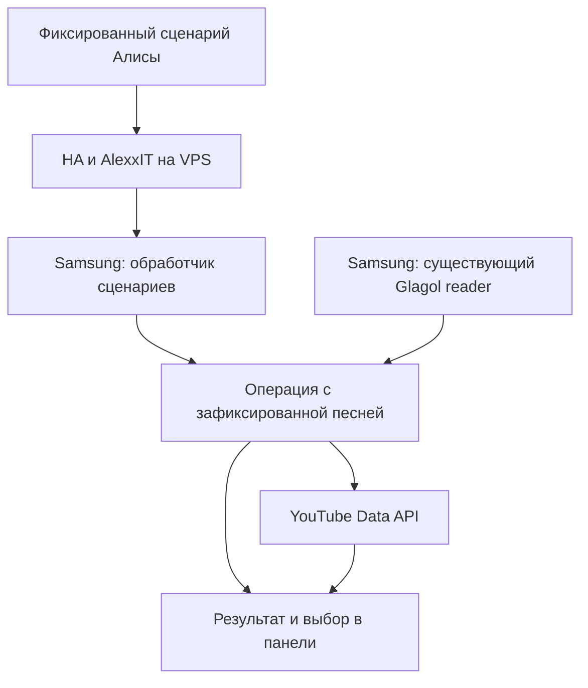

# Текущая песня Станции → понравившаяся музыка YouTube Music

**Статус: архив исходного исследования от 24.11.2026.** При его подготовке аккаунт Google не подключался; аппаратные проверки автором исследования не выполнялись. Ниже сохранён первоначальный проект, который не является описанием текущего кандидата.

Позже исполнитель реализовал сохранение в PR #373 (`a81166047e44442874ddd6c8a1b0f80f33018622`): каталог ytmusicapi, официальный лайк и проверка рейтинга через Happ; две фразы проверены на Mini 2. Отдельные ID наблюдались в Music через браузер, но программное чтение Music текущим Desktop OAuth вернуло 400. Актуальная реализация, фактически выданный OAuth scope и ограничения — в [отчёте ветки реализации](https://github.com/decorum-guy/artem-control-center/blob/a81166047e44442874ddd6c8a1b0f80f33018622/docs/YOUTUBE_CURRENT_TRACK.md). Не заменять этот отчёт архивным текстом при объединении веток.

Далее в PR #374 реализована [самостоятельная страница «Музыка»](plans/LIKED_MUSIC_LIBRARY_2026_11_24.md): новый компактный плеер, выбор плейлистов YouTube с обложками и запуск выбранной песни через соответствующий Яндекс-ID. В [отчёте второго раунда](https://github.com/decorum-guy/artem-control-center/blob/571bf39f445fa27cc898b950bcc9dfd3e0769bb7/docs/plans/MUSIC_LIBRARY_ROUND2_RESULTS_2026_11_24.md) чтение Music подтверждено браузерной сессией на Samsung; прежний OAuth 400 не является блокером всей библиотеки. [Проверка исправлений](plans/MUSIC_LIBRARY_ROUND2_REVIEW_2026_11_24.md) принимает R1–R5 и подтверждает CI. Музыкальный голосовой ответ остаётся непринятым: HA принял текст, владелец его не услышал. Облачный сценарий AlexxIT переиспользуется для разных команд, поэтому его поздний снимок не доказывает причину тишины. Новых подключений к аккаунтам автор этой документационной правки не выполнял.

Основания разделены: уточнение владельца в чате; прочитанный код кандидата Control Center `01933813bd4337731bedf35b62ea455f06468a28`; отчёт исполнителя и подтверждения владельца; первичные документы сервисов. Сравнение с новым `e787ce4a258b8bd09858db44b3192398ec623fa6` подтвердило, что разобранные ниже `station_playback.py`, `tv_voice.py` и `home_assistant.py` не изменились; ссылки на точную исследованную ревизию сохраняются. Предлагаемые классы, файлы и capability ниже пока не существуют, если прямо не сказано обратное. Перед реализацией сверить актуальные исходники и [итог раунда завершения кандидата](plans/SAMSUNG_FINISHING_ROUND_2026_11_24.md).

## 1. Продуктовый контракт

Владелец слушает музыку на Станции Мини 2 и произносит фиксированную команду, например «Алиса, добавь песню в ютуб». Объект действия — композиция, которая играет в этом контексте. Название песни и плейлиста из речи не извлекаются; команд «добавь X» в scope нет.

Рабочая трактовка назначения — **«Понравившаяся музыка» в YouTube Music**, по аналогии с существующим жестом «поставь лайк». При первой настройке показать это назначение и выбранный профиль владельцу. Его не требуется повторять в каждой команде. Обычный лайк Яндекс Музыки сохраняет своё поведение; новая функция вызывается отдельной фразой.

Критерий результата: соответствующая музыкальная запись появляется в нужном разделе YouTube Music нужного профиля. Создание обычного плейлиста или запуск YouTube на ТВ не подменяют этот результат. Воспроизведение YouTube Music на самой Мини 2 — другая задача и здесь не проектируется.

Функция должна работать без постоянно включённого Mac. HA остаётся на VPS; локальный reader и операция сохранения принадлежат Samsung. Для фиксированного сценария отдельный навык с разбором произвольной речи и исследование прошивки не требуются.

## 2. Что уже доступно

| Звено | Проверенное основание | Граница |
| --- | --- | --- |
| Фиксированная фраза → сценарий → `yandex_scenario` → Samsung | TV voice bridge в кандидате; четыре голосовые ТВ-команды подтверждены владельцем | Регистрация новой фразы и её живая приёмка ещё нужны. |
| Станция → Samsung по Glagol | Один авторизованный reader, title/subtitle/cover, состояние и `playerState.id` в парсере | Публичный `StationPlayback` ID не сохраняет; контекст команды ещё не реализован. |
| Запись оценки YouTube | Официальный `videos.rate` и проверка `videos.getRating` | API подтверждает оценку `videoId`, а не присутствие в библиотеке Music. |
| YouTube-лайки в Music | Справка Music и публикация о настройке показа лайков YouTube | Значение настройки, каталог, профиль и задержка отображения в аккаунте владельца не проверены. |

Источники проекта: [отчёт](https://github.com/decorum-guy/artem-control-center/blob/01933813bd4337731bedf35b62ea455f06468a28/docs/plans/SAMSUNG_AUTONOMOUS_RESULTS_2026_11_24.md), [reader](https://github.com/decorum-guy/artem-control-center/blob/01933813bd4337731bedf35b62ea455f06468a28/apps/panel-agent/src/panel_agent/station_playback.py), [TV bridge](https://github.com/decorum-guy/artem-control-center/blob/01933813bd4337731bedf35b62ea455f06468a28/apps/panel-agent/src/panel_agent/tv_voice.py). Официальный механизм фраз: [Яндекс](https://alice.yandex.ru/support/ru/smart-home/scenarios/voice), [AlexxIT v3.22.3](https://github.com/AlexxIT/YandexStation/blob/v3.22.3/README.md#получение-команд-от-станции).

## 3. Первый маршрут: официальный YouTube Data API

### Значение успешного ответа

Предлагаемая последовательность для уже определённого `videoId`:

1. `videos.getRating`: узнать личную оценку в подключённом профиле.
2. При уже установленном `like` вернуть результат «уже отмечено», без новой записи.
3. Иначе `videos.rate` с `rating=like`.
4. После ответа перечитать `getRating` и сопоставить ожидаемые ID и оценку.

`rate` устанавливает абсолютную оценку, возвращая при успехе HTTP 204. Это не toggle. `getRating=like` — программное подтверждение оценки конкретного видео; публичный счётчик лайков не служит readback. API key не заменяет OAuth владельца. Источники: [rate](https://developers.google.com/youtube/data/reference/rest/v3/videos/rate), [getRating](https://developers.google.com/youtube/data/reference/rest/v3/videos/getRating).

### Почему отдельно проверяется Music

В YouTube Music лайк, сохранение в библиотеку и добавление в плейлист — разные действия. Снятие лайка само по себе не обязано удалять запись из библиотеки. [Справка Music](https://support.google.com/youtubemusic/answer/6313542?hl=ru).

В публикации YouTube о настройке **Show your liked music from YouTube** описана связь YouTube-лайков с Likes playlist и рекомендациями Music. Это историческое объявление, а не подтверждение нынешнего значения или расположения настройки у владельца. Проверить её фактическое состояние; не переключать скрытно, поскольку настройка затрагивает и другие лайки аккаунта. [Публикация](https://support.google.com/youtubemusic/thread/82575568/new-setting-lets-you-separate-your-likes-on-youtube-from-youtube-music?hl=en).

Поэтому первый эксперимент должен проверить появление одной заранее сопоставленной музыкальной записи именно в Music. Если личный лайк подтверждён API, но нужного результата в Music нет, записать конкретный блокер. Обычный плейлист не является автоматической заменой цели.

`ytmusicapi` предоставляет музыкальные операции, но сам проект называет себя неофициальным и описывает эмуляцию веб-запросов. Это возможный предмет отдельного исследования при недостаточности официального маршрута, а не незаметная смена адаптера или способа авторизации в первой реализации. [Документация проекта](https://ytmusicapi.readthedocs.io/en/stable/).

### Следующий исследовательский срез: readback именно Music

В проверенной версии `ytmusicapi 1.12.4` есть `get_liked_songs(limit=100)`, вызывающий `get_playlist("LM", limit)`. Найденный ожидаемый `videoId` в `tracks` — положительное свидетельство присутствия записи в списке, возвращённом Music для этого профиля. `get_library_songs` читает другую проекцию и не заменяет эту проверку. Это вывод из кода, а не выполненный запрос к аккаунту владельца. [Методы библиотеки](https://ytmusicapi.readthedocs.io/en/stable/reference/library.html), [реализация LM](https://github.com/sigma67/ytmusicapi/blob/1.12.4/ytmusicapi/mixins/playlists.py).

Предпочтительный дополнительный эксперимент: оставить запись через официальный `videos.rate`, а неофициальный адаптер проверить сначала только как источник чтения LM. Сопоставить конкретный ID, профиль и интерфейс Music. Если официальный лайк действительно не даёт нужного результата, отдельно исследовать `rate_song(videoId, LikeStatus.LIKE)` и повторное чтение LM; заранее обещать другое поведение этой операции нельзя. [Запись rate_song](https://github.com/sigma67/ytmusicapi/blob/1.12.4/ytmusicapi/mixins/library.py).

Неполная выборка не доказывает отсутствия записи. `limit=None` описан как полный обход, но для нашего адаптера всё равно нужны собственные ограничения времени/размера/числа запросов и понятный результат «не найдено в прочитанной части». Лимит библиотеки не считать строгим бюджетом транспорта; порядок и задержку появления измерять. [Playlist API](https://ytmusicapi.readthedocs.io/en/stable/reference/playlists.html).

Штатная OAuth-инструкция `ytmusicapi` предлагает TV/device flow и scope `youtube`; её нельзя механически переносить на Samsung с браузером. Код допускает внешний Bearer (`OAUTH_CUSTOM_FULL`), поэтому чтение LM с уже полученным Desktop token и прежним `youtube.force-ssl` является проверяемой гипотезой. При отказе зафиксировать блокер; не расширять scope и не переходить на cookies скрытно. [OAuth библиотеки](https://ytmusicapi.readthedocs.io/en/stable/setup/oauth.html), [разбор авторизации](https://github.com/sigma67/ytmusicapi/blob/1.12.4/ytmusicapi/auth/auth_parse.py). Лимиты официального Data API не описывают гарантированные квоты этих внутренних Music-запросов.

## 4. Авторизация и профиль

### Рекомендуемая настройка

Для нового личного проекта рассмотреть **Google Personal mode** и OAuth client **Desktop app**. По текущей документации Personal допускает только Google Account создателя, не требует OAuth verification и не имеет семидневного истечения тестового разрешения. Режим выбирается при создании; существующий External/Internal проект нельзя преобразовать в Personal. Это следует проверить в фактической консоли владельца. [Audience](https://support.google.com/cloud/answer/15549945), [исключения из verification](https://support.google.com/cloud/answer/13464323).

При существующем External-проекте отдельно проверить publishing status. `Testing` для YouTube scopes имеет семидневное истечение разрешения и refresh token; добавление владельца в test users этого не отменяет. Не представлять такой режим как постоянную авторизацию.

Одноразовая настройка включает создание/выбор проекта, включение YouTube Data API v3, Desktop client, принятие необходимых условий и OAuth-вход владельца. Это не обещание «всего одного клика». [Google Auth setup](https://support.google.com/cloud/answer/15544987).

Предпочтительный flow — системный браузер Samsung и временный listener на свободном `127.0.0.1`-порту: authorization code, PKCE S256, проверяемый случайный `state`, обмен кода и закрытие listener. Браузер и callback должны находиться на одной машине; открытие Samsung loopback URL на iPhone не эквивалентно. Не нужен публичный callback, embedded WebView или ручная передача кода в чат. [Desktop OAuth](https://developers.google.com/identity/protocols/oauth2/native-app).

### Полномочия и хранение

Для `rate` и его readback достаточно одного scope `https://www.googleapis.com/auth/youtube.force-ssl`. Узкого likes-only scope в рассмотренном API нет: разрешение также покрывает другие изменения YouTube-контента. В настройке честно объяснить этот объём; код панели предоставляет только фиксированную операцию сохранения. Отдельный `youtube.readonly` поверх него не нужен; чисто читающий эксперимент может использовать readonly. [Scopes](https://developers.google.com/identity/protocols/oauth2/scopes), [getRating](https://developers.google.com/youtube/data/reference/rest/v3/videos/getRating).

Google credentials имеют отдельную схему и файл вне Git/frontend. Переиспользовать проверенный механизм DPAPI CurrentUser под тем же Windows-пользователем, который запускает runtime; не использовать LocalMachine. Защищать refresh token, атомарно обновлять файл, не печатать callback/code/tokens в логи. [Microsoft DPAPI](https://learn.microsoft.com/en-us/windows/win32/api/dpapi/nf-dpapi-cryptprotectdata).

Проверить реальное обновление access token после перезапуска без нового входа. Refresh token может быть отозван или утратить действие; `invalid_grant` ведёт в `auth_required`, а не в бесконечный consent/retry. Замена credentials отменяет старый контекст и ожидающие записи. [Истечение OAuth tokens](https://developers.google.com/identity/protocols/oauth2#expiration).

### Google Account и канал YouTube

До первой записи выполнить `channels.list(part=id,snippet,mine=true)`, показать имя и ID подключённого канала и подтвердить нужную идентичность в настройке. Не выбирать молча первый элемент при неоднозначном ответе. Официальная справка предупреждает о выборе неверного канала сторонними приложениями, особенно при Brand Accounts. Совместимость нового Personal mode с конкретным Brand channel владельца в этом исследовании не проверена. [Brand Accounts](https://support.google.com/youtube/answer/3046478), [channels.list](https://developers.google.com/youtube/data/reference/rest/v3/channels/list).

## 5. Захват именно нужной композиции

### Ограничения текущего кода

`parse_state()` принимает музыкальный `playerState.type == "Track"`, извлекает ID, title и subtitle. Сейчас ID используется для статистики удержания; `StationPlayback` его не хранит. `observedAt` обновляется и на повторных paused-кадрах. В отчёте уже есть `стоп → paused` с долгим сохранением метаданных. Поэтому свежий `observedAt` не доказывает недавнее воспроизведение.

Голосовое событие также не даёт точного момента фразы. AlexxIT v3.22.3 читает историю голосовых запусков, но в `yandex_scenario` не переносит исходные `launch_time` и ID запуска. `entity_id` относится к колонке, назначенной действием сценария, а не достоверно к услышившему микрофону. `HA time_fired` — время публикации HA-события. [Quasar](https://github.com/AlexxIT/YandexStation/blob/v3.22.3/custom_components/yandex_station/core/yandex_quasar.py#L536), [публикация события](https://github.com/AlexxIT/YandexStation/blob/v3.22.3/custom_components/yandex_station/core/yandex_station.py#L248).

**Следствие:** не обещать точное восстановление песни на момент произнесения по одному `HA time_fired`. На первом этапе команда явно привязана к настроенной Мини 2. Разговор с другой колонкой аккаунта сам по себе не переключает источник музыки.

### Предлагаемый внутренний TrackContext

В существующем единственном reader хранить:

- непрозрачный source track ID, название, исполнитель, подтверждённый тип медиа;
- состояние, время последнего валидного кадра, `lastPlayingAt` и `pausedAt`;
- поколение соединения и ограниченную историю смен ID/состояния/разрывов.

Возраст внутри процесса считать монотонными часами; UTC использовать для отображения. История обновляется при смене ID даже при одинаковых title/artist/cover. Повторные paused-кадры не продлевают `lastPlayingAt`. Это отдельный контекст операции, а не переделка или очистка существующей статистики retention.

Приняв допустимый trigger, **синхронно зафиксировать неизменяемый контекст до первого await/поиска**. При неоднозначности A/B фиксируется набор исходных контекстов; владелец выбирает песню из этого набора, после чего источник операции уже не меняется. Последующая смена песни на Станции не заменяет зафиксированные данные.

| Наблюдаемый контекст | Политика |
| --- | --- |
| Свежая играющая песня без недавней смены/разрыва | Захватить текущую композицию. |
| Та же песня недавно перешла в pause при непрерывном соединении | Допустить этот контекст в пределах проверенного окна; это учитывает обращение к Алисе. |
| Недавно сменились A и B, голосовой запрос мог попасть между ними | Предложить выбор между уже известными песнями в панели; автоматической записи нет. |
| Долгая пауза, idle, stale, auth_required либо только восстановленные метаданные после reconnect | Не выполнять автоматическое сохранение. |
| ID отсутствует или контекст невозможно различить | Не выдавать его за однозначный; показать доступное подтверждение/причину. |

Числа окна недавней паузы и неоднозначности определяются после наблюдения голосового пути. Текущий TV guard в 12 секунд ограничивает возраст опубликованного события, а не весь путь от фразы; переносить его как доказанный предел нельзя.

У upstream есть `aliceState` и `timeSinceLastVoiceActivity`. Их переходы/единицы на этой Мини 2 не подтверждены. Узкая проверка тем же reader допустима при реализации: значения состояний, локальные времена и смены track ID без записи речи/сырых аккаунтных payload. Даже подтверждённое начало взаимодействия с Алисой не доказывает, что это была именно команда сохранения. [Атрибут aliceState](https://github.com/AlexxIT/YandexStation/blob/v3.22.3/custom_components/yandex_station/core/yandex_station.py#L224).

## 6. Поиск соответствующей записи

Первую вертикальную проверку провести с заранее подтверждённой парой source track ID → YouTube videoId. После неё реализовать поиск для ранее не встречавшихся песен; одной заранее заданной пары недостаточно для завершения всей функции.

Предлагаемый порядок:

1. Использовать ранее подтверждённое соответствие при совпадении источника, ID и версии контекста; проверить доступность кандидата.
2. Для нового трека запросить `search.list(type=video, q=исполнитель + название)` с небольшим ограничением результатов; получить сведения о кандидатах через `videos.list`.
3. Сопоставить исполнителей, название и признаки версии. Длительность сравнивать только если она достоверно доступна с обеих сторон; добавлять её во внутренний контекст можно без нового прогресса/перемотки в виджете.
4. Не стирать значимые слова `live`, `cover`, `remix`, `acoustic`, `remaster`, `sped up`. Канал Topic, популярность или `licensedContent` сами по себе не доказывают точное совпадение.
5. При нескольких правдоподобных кандидатах показать компактный выбор в панели. Пользователь выбирает из найденного, а не диктует название. Подтверждённое соответствие можно переиспользовать.

`search.list` ищет ресурсы YouTube, а не единую музыкальную запись по ISRC. Документированный video resource не предоставляет поле ISRC; source ID Яндекса не является `videoId`. Автоматический выбор первого результата не принимается как готовый matcher. Критерии уверенного совпадения нужно проверить на реальных примерах, без выдуманной процентной точности. [Поиск](https://developers.google.com/youtube/data/reference/rest/v3/search/list), [video resource](https://developers.google.com/youtube/data/reference/rest/v3/videos), [videos.list](https://developers.google.com/youtube/data/reference/rest/v3/videos/list).

Кэш поиска ограничен по размеру и сроку; хранить время проверки и происхождение соответствия. Политику обновления/удаления API-метаданных согласовать с актуальными [правилами YouTube API](https://developers.google.com/youtube/terms/developer-policies); бессрочное хранение сырого ответа не нужно. Личные названия/истории прослушивания не публикуются в Git.

## 7. Подключение в Control Center

Предлагаемая схема:

Новый поиск/worker не создаёт дополнительный WebSocket к Станции и не уменьшает глобальный polling панели.

| Место | Минимальное изменение |
| --- | --- |
| `apps/panel-agent/src/panel_agent/station_playback.py` | Внутренний TrackContext и история семантических переходов в существующем reader. |
| `apps/panel-agent/src/panel_agent/home_assistant.py` | Один dispatcher `yandex_scenario` для независимых разрешённых обработчиков. Подписка нужна при включении TV voice **или** music save. |
| Предлагаемый `music_save.py` | Фильтр фиксированного сценария, захват песни, bounded worker, дедупликация и lifecycle операции. |
| Предлагаемый `youtube_music.py` | Фиксированные Google endpoints, OAuth refresh, поиск кандидатов, `getRating`/`rate`, проверка канала. Название не означает доступ к отдельному официальному Music API. |
| `main.py`, `settings.py`, `access_policy.py`, реестр capabilities | Отдельный opt-in и предлагаемая capability `media.youtube.save_current`; readiness, global write gate, профиль доступа. |
| `packages/contracts/` и обычный UI Станции/настроек | Нормализованное состояние подключения и операции; выбор только подготовленных кандидатов. |

Сейчас `home_assistant.py` имеет один `set_yandex_scenario_handler`, а подписка привязана к `tv_voice_enabled`. Повторная установка handler затрёт TV callback; включение музыки не должно зависеть от флага телевизора. Действие `youtube` в нынешнем TV bridge означает открытие приложения на ТВ и остаётся таким. [Текущая подписка](https://github.com/decorum-guy/artem-control-center/blob/01933813bd4337731bedf35b62ea455f06468a28/apps/panel-agent/src/panel_agent/home_assistant.py#L802).

Вход принимает только `event_type=yandex_scenario`, ожидаемый `origin`, настроенную target entity, точное имя выделенного сценария и ожидаемые `instance/value`. Проверять непустой `context.id`, допустимый возраст и ограниченный уход `time_fired` в будущее; повторную доставку одного события отбрасывать. `origin=LOCAL` не доказывает источник микрофона, а возраст HA-события не определяет время произнесения. Не принимать название песни, URL или provider command из произвольного payload. Разрешение перепроверяется непосредственно перед внешней записью: оно может измениться за время поиска. Новый источник отказов не блокирует ТВ, напоминания или другие виджеты.

### Повторы, неопределённость и пользовательский результат

- Один запрос создаёт одну операцию с собственным ID, поколением credentials, выбранным каналом и зафиксированной песней либо неизменяемым набором исходных контекстов A/B до выбора владельца.
- Дедуплицировать повторное HA-событие и уже выполняемое сохранение того же контекста. `context.id` относится к публикации HA и не является глобальным ID исходного запуска сценария.
- После timeout записи сначала разрешено ограниченное чтение оценки. Повторная запись автоматически не выполняется. При неизвестном результате сохраняется статус неопределённости.
- После перезапуска незавершённую запись не воспроизводить; можно проверить её результат чтением, если сохранён минимальный контекст и авторизация не менялась.
- Короткий cooldown ТВ не заменяет дедупликацию и readback музыкальной операции.
- Выбор исходной песни A/B и выбор соответствующей записи YouTube — разные этапы. Подтверждение принимает `operation_id`, ожидаемый этап и ID одного из сохранённых сервером вариантов этого этапа. Просроченные варианты и чужие ID отклоняются.

Технически различать `youtube_like_confirmed` и подтверждение отображения конкретной записи в Music. В UI показывать понятный результат с названием песни: «Лайк сохранён в YouTube», «Уже отмечено», «Выбери песню», «Выбери версию песни», «Нужен вход» или «Результат пока не подтверждён». Приёмка одной пары не подтверждает отображение всех будущих `videoId` в Music. Пока присутствие конкретной записи в Music отдельно не проверяется, результат остаётся «Лайк сохранён в YouTube» и после общей приёмки маршрута. Продуктовая цель остаётся Music и не считается доказанной для записи одним API-readback; ограничение официального адаптера должно оставаться явным.

Периодических голосовых сообщений не добавлять. Короткий ответ на явную команду можно рассмотреть после подтверждения записи; фоновое чтение и восстановление авторизации не должны заставлять Алису неожиданно говорить.

## 8. Квоты и сеть

По официальным страницам, просмотренным 24.11.2026, default allocation: отдельные 100 вызовов `search.list` в день и 10 000 общих единиц для остальных обычных методов. Поиск расходует одну единицу своего bucket; `videos.list` и `getRating` — по одной общей, `rate` — 50. Фактические лимиты проекта сверяются в Console. Не переносить старое предположение «поиск стоит 100 общих единиц». [Quota Calculator](https://developers.google.com/youtube/data/determine_quota_cost).

Расчёт одного полного прохода с одним поиском, одним запросом сведений, чтением оценки до/после и записью: один поисковый вызов и 53 общие единицы. Это расчёт по документации, не измерение реализации. Подтверждённые соответствия и уже установленный like уменьшают расход; бесконечный поиск и постраничный обход не нужны.

До OAuth/приёмки проверить доступность нужных Google endpoints из Samsung. Временное отключение `kz-bot` описано в [карте доступа](INFRASTRUCTURE_ACCESS.md#временное-состояние-kz-bot). Пока известно только, что от него зависит Telegram-бот; зависимость Google от него не установлена. Не менять глобальный proxy и не прокладывать новый маршрут по предположению. Доступ к API и отображение сайта Music проверяются отдельно.

## 9. Этапы реализации и приёмки

### A. Доказать назначение на одной песне

Подготовить OAuth, защищённое хранение и read-only проверку канала. Владелец проходит вход/2FA и подтверждает назначение один раз. Выбрать музыкальную запись, соответствие которой текущей песне проверено. Выполнить явный тест `rate`/`getRating` и наблюдать появление в Music у того же профиля. Перед тестом зафиксировать прежнюю оценку; уборка касается только созданного тестом изменения и не удаляет прежний пользовательский лайк.

Записать отдельно время отправки/ответа/readback/появления в Music. Не выдавать API-задержку за задержку всей голосовой цепочки. При несовпадении назначения остановить объявление готовности и описать конкретную причину.

### B. Подключить фиксированную фразу и контекст Станции

Зарегистрировать один сценарий и нужные фиксированные синонимы после проверки коллизий. Проверить голосом с физической Мини 2: команда → правильная зафиксированная песня → лайк → Music. Программный запуск сценария/команда через HA не заменяют этот тест: в отчёте #372 эти способы уже дали разные результаты.

Проверить смену песни во время поиска, близкую смену до доставки события, короткую и долгую паузы. При обращении к Алисе измерить реальные переходы; не заранее объявлять все paused-состояния равнозначными.

### C. Автоматическое сопоставление новых песен

Добавить поиск и небольшой UI выбора неоднозначного кандидата. Проверить ранее не сопоставленные русскоязычные и англоязычные треки, составного исполнителя, разные версии и одно отсутствие подходящего результата. Для каждого принятого примера проверить идентичность записи; не считать выбор правильным только по API-успеху.

Цель закончена, когда обычная команда сохраняет новую однозначную песню без диктовки названия и лишнего подтверждения, редкая неоднозначность разрешается понятным выбором, а ошибки не порождают неправильный лайк. Отчёт отдельно указывает записи, для которых наблюдался результат в Music, и операции, подтверждённые только как YouTube-like. Если нужна программная гарантия присутствия каждого нового кандидата именно в Music, отсутствие такого readback у официального адаптера остаётся открытым требованием, а не закрывается одной успешной приёмкой.

### D. Надёжность и передача в постоянный runtime

Адресные тесты:

- trigger на A, во время поиска B — записывается A;
- A→B перед запоздалым событием — выбор/отказ от автоматической записи;
- свежий paused-кадр после долгого stop не делает `lastPlayingAt` свежим;
- разные source ID с одинаковым текстом остаются разными;
- reconnect/новые credentials не наследуют старую возможность записи;
- повторы HA, старое событие, недопустимое будущее время, отсутствующий ID, отзыв gate во время поиска, неверный target/scenario и неопределённая запись;
- OAuth callback state/PKCE, отказ/отзыв/refresh и неверный канал;
- одна подписка `yandex_scenario` в существующем HA WebSocket и один Glagol reader, без удаления других HA-подписок и без регрессии ТВ;
- matcher не выбирает первый результат при неоднозначности; readback сверяет нужный ID.

Далее — применимые проверки проекта, изолированный preview и отчёт с разделением CODE / искусственных тестов / живых наблюдений / подтверждений владельца. GitHub Actions и тяжёлые артефакты — по действующим ограничениям владельца. Merge и основной runtime — отдельный шаг по [RULES.md](../RULES.md).

## 10. Решения, которые нельзя выдавать за уже проверенные

- Сохранение через официальный API пока не испытано на аккаунте владельца.
- Назначение «Понравившаяся музыка» — рабочая трактовка, которую нужно явно показать при первом подключении.
- Выбор конкретного канала, состояние настройки YouTube-лайков и Personal/Brand совместимость ещё не проверены.
- Полная задержка голосового события, подходящее окно контекста и полезность `aliceState` требуют наблюдения на Мини 2.
- Качество matcher и семантика Music проверяются по фактическому результату, не по количеству зелёных unit-тестов.
- Обновление этой документации не меняет серверы, credentials, Яндекс-сценарии или Google-аккаунт.
